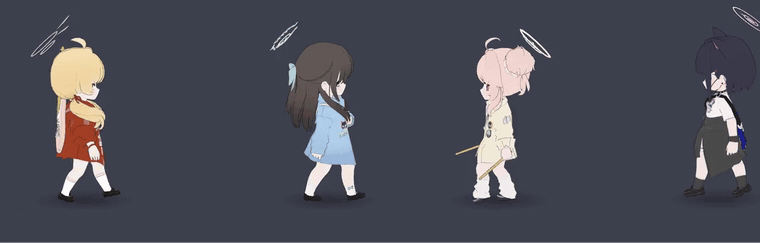

# 샬레 당번 — 블루 아카이브 데스크톱 펫

바탕화면 위를 블루 아카이브 학생들이 돌아다닙니다. 걷고, 낮잠 자고, 가끔 총을 꺼내 전투를 벌이고, 같이 띄운 학생들이 모이면 합동 승리 포즈까지.

  

  <a href="https://github.com/dxsworks/SD_archive/releases/latest"><b>⬇ 설치 파일 받기 (Windows)</b></a>

## 할 수 있는 것

- **학생 264명** — 처음엔 호시노 한 명이고, 나머지는 메뉴에서 고르면 그 학생만 받아 옵니다(학생당 몇 MB)
- **최대 4명 동시에** — 학생마다 따로 돌아다니고 따로 반응합니다
- **합동 승리** — 게임 속 합동 승리 조합(16가지) 학생이 다 떠 있고 가까이 모이면 함께 포즈를 취합니다. 우클릭 메뉴에서 조합에 필요한 학생을 보고 바로 부를 수도 있어요
- **바탕화면이 바닥** — 화면 위쪽은 멀리, 아래쪽은 가까이. 앞뒤·대각선으로 걸으며 옆모습·뒷모습도 보입니다
- **혼자 두면 알아서** — 걷기, 카페 반응, 잠깐 총 들기, 낮잠, 가끔 전투 모드(사격·재장전·구르기·EX 스킬 → 승리 포즈)
- **종료하면** 헬기 밧줄을 잡고 화면 위로 끌려 올라갑니다
- 캐릭터가 없는 투명한 부분은 클릭이 그대로 아래 창으로 갑니다
- 새 버전이 나오면 알아서 받아 두고, 종료할 때(또는 메뉴 "업데이트하고 다시 시작") 설치

## 설치

1. [릴리스 페이지](https://github.com/dxsworks/SD_archive/releases/latest)에서 `BlueArchivePet-Setup-<버전>.exe`를 받아 실행합니다.
2. 서명이 없는 프로그램이라 처음에 Windows SmartScreen 경고가 뜹니다. **추가 정보 → 실행**을 누르세요.
3. 설치가 끝나면 바탕화면의 **샬레 당번**으로 켭니다. 작업 표시줄 오른쪽 트레이에 아이콘이 생깁니다.

Windows 10/11(64비트)용입니다. 앱을 삭제하면 받은 학생과 설정도 같이 지워집니다.

## 조작

| 이렇게 하면 | 이렇게 돼요 |
|---|---|
| 클릭 | 반응. 자고 있으면 깨어나고, 전투 중이면 구호나 재장전 |
| 더블클릭 | EX 스킬을 쓰고 전투 모드로 |
| 끌기 | 집어 들어 원하는 곳에 내려놓기 |
| 우클릭 (캐릭터 또는 트레이 아이콘) | 메뉴: 동작, 학생 바꾸기·받기, 학생 하나 더 띄우기, 크기, 돌아다니기, 항상 위, 클릭 효과, 종료 |

학생 메뉴는 학원 → 학생 순으로 나뉘어 있고, 아직 안 받은 학생은 크기(`↓ 2.7MB`)와 함께 나옵니다.

## 자주 묻는 것

- **GPU를 많이 쓰나요?** 창 전체가 아니라 캐릭터 둘레만 그려서 가볍게 만들었습니다(60fps).
- **학생이 화면 밖으로 잘려요.** 탈것·큰 소품을 쓰는 몇몇 EX는 화면 끝에서 잘릴 수 있습니다. 메뉴 → 위치 초기화로 가운데로 불러올 수 있어요.
- **버그·요청은** [Issues](https://github.com/dxsworks/SD_archive/issues)에 남겨 주세요.

## English

A Blue Archive desktop pet for Windows. Students walk around your desktop, take naps, sometimes break into a firefight, and when the right members are on screen together they perform their joint victory pose. Up to 4 students at once, 264 students downloadable from inside the app. [Download the installer](https://github.com/dxsworks/SD_archive/releases/latest) — SmartScreen will warn because the installer is unsigned; click *More info → Run anyway*.

## 만든 방법

Electron + three.js. 학생 3D 모델은 [lihaohong6/BlueArchiveModels](https://github.com/lihaohong6/BlueArchiveModels)의 것을 씁니다. 직접 빌드하거나 코드를 고치려면 [docs/development.md](docs/development.md)를 보세요.

## 고지

팬이 만든 비공식·비영리 프로그램이며 NEXON Games·Yostar와 관련이 없습니다. 블루 아카이브의 캐릭터·모델·동작에 대한 권리는 원저작권자에게 있습니다. 권리자의 요청이 있으면 내리겠습니다.
